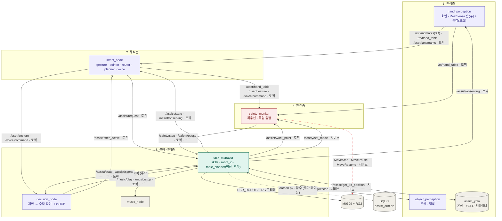

# 협동2 통합 설계 v2.3 — RealSense 중심 손 인식 + 담당별 인식층 + 세팅·정리 RL (2026-11-26)

v2.1(팀 저장소 `rokey_B4_2`, `ho1` 브랜치 `98f9240`의 **실제 `assist_arm` 코드 기준**)에 검토 의견 4가지(재개, 단위 경계, 완료 판정, 그릇 구분)를 반영한 v2.2에, **손 인식을 RealSense(3D) 중심으로 바꾸고 인식층을 담당별로 나눈** 버전이다. v2.0~v2.2 문서는 비교용으로 그대로 둔다.
표의 **상태** 칸: `기존` = 코드에 이미 있음, `추가` = 새로 넣어야 함 (v2.1·v2.2), `확인` = 코드 확인이 더 필요함.

## v2.2 → v2.3 변경 요약

| # | 항목 | v2.3 결정 | 위치 | 상태 |
|---|---|---|---|---|
| E | 손 인식의 주 카메라 | **손목 RealSense가 주(3D 깊이)**, 웹캠은 **보조(2D, 깊이 없음)**. 손동작 학습·인식은 RealSense 기준 | 1.3 | 방향 변경 |
| F | 인식층 담당 | **손 인식은 호연**(`rs_hand_node`를 은상 → 호연), **물체 인식은 은상**(YOLO + 얼룩). 프로세스를 카메라별이 아니라 **담당(기능)별**로: `hand_perception`(호연), `object_perception`(은상) | 0, 2, 4 | **완료**(진입점·런치 변경, 12장) |
| G | 손동작 3D 입력 | 지금 손동작 모델은 **깊이를 쓰지 않음**(MediaPipe 추정 3D + 이미지 평면 속도). RealSense 깊이 관절(`hand_cam`)을 `/rs/landmarks`에 실어 보내고, 특징 v3로 학습·인식 | 1.3 | **추가** |
| H | 웹캠의 역할 | 버리지 않음: 로봇 이동 중 안전 감시(손·팔 근접), 이동 중 "멈춤" 손동작, RealSense가 손을 못 볼 때 대체, 상체·사람 위치 | 1.3 | 기존 유지 |
| I | 정정 | v2.1·v2.2에서 "`/rs/landmarks` 구독 노드 없음"은 **틀림** → `gesture_node`가 파라미터 `rs_landmarks_topic`으로 구독함 | 3.1 | 정정 |
| J | RTMPose | 지금은 비교 도구(`tools/live_compare.py`)에만 있음. `rs_hand_node`에 손 관절 백엔드 선택(`mediapipe` / `rtmpose` / `hybrid`)을 두고, 비교에서 이기면 바꿈 | 1.3 | 선택 |

## v2.1 → v2.2 변경 요약 (참고)

| # | 항목 | v2.2 결정 | 위치 | 상태 |
|---|---|---|---|---|
| A | 일시정지 후 재개 | 자동 재개를 **파라미터 `auto_resume`**로 두고 **실물 첫 시험·시연은 끔**(담당자 확인 후 재개). 정지 **해제(허가)**와 동작 **재개(명령)**를 구분 | 6.2 | **추가** |
| B | 좌표 단위 | 내부·두산 경로는 **mm 유지**. ROS 표준 타입에 담긴 mm 값은 **RViz·TF에 직접 넣지 않고**, 표준 경로로 넘길 때 **한 곳에서 m로 변환**. 실측점 하나로 양쪽 일치 확인 | 1.1 | **추가**(문서·검증) |
| C | 완료 판정 | `next_action`이 **상태를 함께 반환**: `ACT` / `DONE` / `BLOCKED` / `PERCEPTION_FAIL`. 집은 기록 없이 사라진 그릇은 완료로 세지 않음 | 3.5, 6.7 | **추가** |
| D | 밥그릇·국그릇 구분 | 첫 시연은 **위치로 구분**(보관 더미 칸 고정 + DB 재고, 자리 템플릿). 크기 기반 구분은 실험으로 확인한 뒤 선택 | 1.2 | **추가** |

## v2.0 → v2.1 변경 요약 (참고)

| # | 항목 | v2.1 결정 | 코드 상태 |
|---|---|---|---|
| 1 | 제안 경로 | **`decision_node → task_manager` 직접 연결** (사진대로). 사용자 확인은 decision_node 안에서 함 | 기존 |
| 2 | 안전층 입력 | 손 3D(`/rs/hand_table`, `/user/hand_table`) + **작업 지점(`/assist/work_point`)** + 멈춤 손동작·음성 + heartbeat | 기존 |
| 3 | 안전층 출력 | **일시정지(`/safety/pause` + MovePause/Resume)와 정지(`/safety/stop` + MoveStop)를 구분**, 정지 해제는 `/safety/reset` | 기존 |
| 4 | 스냅샷 | 관찰 자세에서 **task_manager가 YOLO 컨테이너 서비스(`/assist/get_3d_position`)를 직접 호출** | 기존 |
| 5 | 이름 | 토픽·메시지·작업 이름을 **실제 코드 이름**으로 통일 (`TaskRequest`, `/assist/announce`, `/assist/state` 등) | — |
| 6 | 단위 | 코드가 쓰는 **mm**로 통일 (v2.0의 m 규칙 폐기) | 기존 |
| 7 | RL | `table_planner.py`를 task_manager 안에 넣어 정리·세팅 **순서와 목적지**를 결정 | **추가** |
| 8 | 실행 규칙 | 들고 있을 때 복구, 빈손 관측, 보관 재고 DB | **추가** |

---

## 0. 설계 원칙

1. **로봇을 움직이는 것은 `task_manager` 하나**(`robot_io.py`가 DSR_ROBOT2·RG 그리퍼 호출). 예외는 `safety_monitor`의 MoveStop·MovePause·MoveResume.
2. **인식은 담당(기능)별 프로세스.** 손 인식 = `hand_perception`(호연: 손목 RealSense 주 + 웹캠 보조), 물체 인식 = `object_perception`(은상: YOLO 컨테이너 + 얼룩). 카메라 영상은 ROS 토픽으로 나눠 받으므로 한 카메라를 여러 프로세스가 같이 써도 된다.
3. **사용자 명령은 `intent_node`가, 먼저 하는 제안은 `decision_node`가** `/assist/request`로 보낸다. 제안은 사용자가 수락했을 때만 보낸다.
4. **안전층은 독립 실행, 최우선.** heartbeat가 끊겨도 멈춘다.
5. **무엇을 어디로 옮길지는 `table_planner`가 정한다** (RL 또는 규칙 기반, 같은 함수 자리).
6. **관측은 관찰 자세에서 멈추고, 빈손일 때만.**
7. **학습·녹화·DB 도구는 로봇 실행과 분리**한다 (`tools/`).

## 1. 공통 규칙

| 항목 | 규칙 |
|---|---|
| 좌표계 | 로봇 베이스 좌표 (두산 BASE) |
| 단위 | 내부·두산 경로는 **mm, deg** (HandTable, SpillResult, 작업 지점, 두산 API). ROS 표준 경로(RViz, TF)는 **m, rad**. 경계 규칙은 1.1 |
| 네임스페이스 | `/assist/...`(작업·상태), `/user/...`(사람 인식), `/rs/...`(RealSense 손), `/safety/...`, `/spill/...`, `/music/...`, `/voice/...`, 로봇 `/dsr01`, 그리퍼 `robot_control.onrobot.RG` |
| 메시지 패키지 | `assist_arm_msgs` (기존). YOLO는 `od_msg` |
| 물체 클래스 | 코드 기준 `bowl`, `plate`, `cup`, `spoon`, `fork`, `chopsticks` (`config/yolo_classes.yaml`). 밥그릇·국그릇은 YOLO가 아니라 **위치로 구분** (1.2) |
| 작업 이름 | `bring_dish`, `clear_dish`, `clear_empty`, `clear_all`, `pour_water`, `seat_setting`, `music`, `wipe_table`, `scan_scene`, `express`, `observe_table`, `cancel`, **`resume`(추가)** |

### 1.1 단위 경계 (B) — 추가

| 구분 | 단위 | 해당 인터페이스 |
|---|---|---|
| 두산 API·내부 계산 | mm, deg | `robot_io.py`, `skills.py`, `config/*.yaml` 좌표 |
| **ROS 표준 타입이지만 값이 mm** (비표준) | mm | `/assist/work_point`(`PointStamped`), `/user/poke`, `/user/fingertip`(`PointStamped`), `HandTable`의 점들, `SpillResult.position` |
| ROS 표준 경로 | m, rad (REP-103) | TF, RViz 표시, `robot_state_publisher` |

규칙
1. 위 "값이 mm"인 토픽은 **RViz·TF에 직접 넣지 않는다.** 넣으면 1000배 어긋나게 보인다.
2. 시각화나 TF가 필요하면 **변환 지점을 한 곳**(예: `viz_bridge` 노드 또는 `robot_io`의 시각화 함수)에 두고, 거기서만 m로 바꿔 `/viz/...`로 낸다. 기존 mm 경로는 바꾸지 않는다.
3. **실측 검증 (시연 전 1회)**: 테이블 위 마커 한 점을 ① 티칭 펜던트 BASE 좌표(TCP를 직접 가져가서), ② YOLO 검출 좌표(`/assist/get_3d_position`), ③ RViz 표시(변환 후)로 읽어 **±5 mm 안에서 일치**하는지 확인한다. 어긋나면 카메라 TF(브라켓 CAD 공칭값)부터 의심한다.

### 1.2 밥그릇·국그릇 구분 (D) — 추가

| 단계 | 방법 | 근거 |
|---|---|---|
| **첫 시연 (기본)** | **위치로 구분.** 보관 더미는 칸마다 종류 고정(예: A = 국그릇, B = 밥그릇, C = 메인 접시)이고 내용은 `storage_inventory`가 기준. 세팅 뒤에는 자리 템플릿(밥 왼쪽, 국 오른쪽)으로 종류를 앎. 정리 때는 검출된 `bowl`을 **가장 가까운 템플릿 위치**(허용 반경 예: 60 mm)의 종류로 본다 | YOLO 재학습 없이 가능 |
| 위치가 애매할 때 | 허용 반경 밖으로 옮겨졌거나 두 그릇이 겹치면 **임시 자리**에 두고 안내하거나, 사용자에게 묻는다 | 잘못 포개는 것을 막음 |
| 선택 (검증 후) | **크기로 구분**: 검출 폭 + 깊이로 지름을 추정. 두 그릇 지름 차이가 측정 오차보다 충분히 큰지 먼저 실험 | 섞인 위치에서도 구분 가능 |


### 1.3 손 인식과 손동작 (E·G·H) — v2.3

**카메라 역할**

| 카메라 | 역할 | 쓰는 때 | 출력 |
|---|---|---|---|
| **손목 RealSense (주)** | 손 21관절 + **관절별 깊이 3D**. 손동작 학습·인식의 기준 | 관찰 자세에서 로봇이 멈춰 있을 때 (`/assist/observing=true`). 손목 카메라라 로봇이 움직이면 좌표가 틀어짐 | `/rs/landmarks`(손동작용), `/rs/hand_table`(콕·안전용, 베이스 mm) |
| **웹캠 (보조)** | 손 21관절(2D, 깊이 없음) + 상체 33점 | **항상**. 특히 로봇이 움직일 때 | `/user/landmarks`, `/user/hand_table`(테이블 평면 호모그래피, 베이스 mm) |

웹캠이 맡는 일: ① 로봇 이동 중 손·팔 근접 안전 감시(RealSense는 이때 못 씀) ② 이동 중 "멈춤" 손동작(`stop`만) ③ RealSense가 손을 못 볼 때 대체 ④ 사람 위치·상체(자리 가리키기 등). **손동작 학습 데이터에는 쓰지 않는다.**

**지금 코드에서 확인한 사실 (ho1)**

| 항목 | 지금 | 문제 |
|---|---|---|
| `gesture_node` 입력 | `/user/landmarks`(웹캠)와 `/rs/landmarks`(RealSense)를 **둘 다 구독**. 관찰 중이면 RealSense 우선, 아니면 웹캠은 `stop`만 | 구조는 맞음 |
| 손동작 특징 (`features.py`, 버전 2) | 손 모양 = **MediaPipe가 추정한 3D**(`hand_world`, 깊이 센서 아님), 움직임 = **이미지 평면 속도(z = 0)** | **RealSense 깊이를 쓰지 않음.** 앞뒤로 미는 동작(손등 밀기 등)의 깊이 변화를 못 봄 |
| 녹화 도구 (`live_record.py --source realsense`) | 깊이 기반 관절 3D를 **`hand_cam`(카메라 좌표 mm)으로 이미 저장** | 학습(`train_gesture_sklearn.py`)과 실행(`gesture_node`)이 이 값을 안 씀 |
| `/rs/landmarks` 메시지 (`UserLandmarks`) | 이미지 좌표·MediaPipe 3D만 있음 | 실행 중에는 깊이 3D를 전달할 필드가 없음 |
| 시퀀스 모델 입력 | 손 21관절 **+ 상체** | 손목 카메라는 상체를 못 봄 → RealSense 모델은 상체 없이 학습해야 함 |

**v2.3에서 바꿀 것 (담당: 호연)**

| # | 변경 | 내용 |
|---|---|---|
| G1 | `UserLandmarks`에 깊이 3D 추가 | `hand_cam_valid`, `hand_cam[63]`, `hand2_cam_valid`, `hand2_cam[63]` (카메라 좌표 mm, 관절별 깊이 없으면 NaN). `rs_hand_node`가 채움, 웹캠은 비움 |
| G2 | 특징 v3 (`FEATURE_VERSION = 3`) | 손 모양: 손목 기준·손 크기로 정규화한 **깊이 3D**(관절 깊이가 빠지면 MediaPipe 3D로 채움). 움직임: 손바닥 중심의 **3D 속도(z 포함)**. 상체 없음 |
| G3 | 학습 | `live_record.py --source realsense`로 녹화 → `train_gesture_sklearn.py --sources realsense`, GRU 노트북도 v3 특징. **학습과 실행이 같은 `features.py` 함수**를 씀 |
| G4 | 실행 | `gesture_node`: RealSense 입력은 v3 모델, 웹캠 입력은 기존 v2 모델 또는 규칙(이동 중 `stop`만). 출처는 `Gesture.source`에 `@realsense` / `@webcam` |
| G5 | 깊이 품질 | D435i 최소 거리(약 10~20 cm)보다 가까우면 깊이 없음, 손가락 끝은 구멍이 잦음 → 관절별 유효 표시, 유효 관절이 적으면 그 프레임은 MediaPipe 3D로 대체 |
| G6 | 손 관절 백엔드 (선택) | `rs_hand_node` 파라미터 `hand_backend` = `mediapipe` / `rtmpose` / `hybrid`. 지금은 MediaPipe. `live_compare.py`로 비교해 정확도가 높은 쪽 선택 |

---

## 2. 노드 리스트

실행 단위는 **프로세스 6개 + YOLO 컨테이너**이고, 각 프로세스 안에 기존 노드들이 함께 돈다(`common/multi.py`의 `run_nodes`).

| 층 | 프로세스 | 안의 노드 | 담당 | 하는 일 | 상태 |
|---|---|---|---|---|---|
| 인식 (손) | **`hand_perception`** | `rs_hand_node`(주, RealSense 3D), `webcam_publisher`·`pose_node`(보조, 웹캠 2D) | **호연** | 손 21관절 + 깊이 3D(관찰 중), 웹캠 손·상체(항상) | 기존 노드 재배치 (v2.3, F) |
| 인식 (물체) | **`object_perception`** | `spill_node` | **은상** | 테이블 얼룩 | 기존 노드 재배치 (v2.3, F) |
| 인식 (물체) | `assist_yolo` (컨테이너) | — | 은상 | 물체 검출 + 3D 위치 서비스 | 기존 |
| 해석 | `intent_node` | `gesture_node`, `finger_pointer`, `request_router`, `claude_planner_node`, `voice_command_node` | 호연(손동작·콕) + 상엽(음성·뜻 풀이) | 손동작·콕·음성 → `/assist/request` | 기존 |
| 결정·실행 | `task_manager` | (`skills.py`, `robot_io.py`, **`table_planner.py`**) | 미정(상태 머신) / **현상**(스킬·planner) | 작업 실행, 스냅샷, 로봇·그리퍼 호출 | 기존 + **추가** |
| 결정·실행 | `decision_node` (선택) | — | 미정 | 먼저 제안 → 수락 확인 → 요청, LinUCB 학습 | 기존 |
| 결정·실행 | `music_node` (선택) | — | 미정 | 음악 재생 | 기존 |
| 안전 | `safety_monitor` | — | 미정 | 근접 일시정지, 멈춤 손바닥·음성 정지, heartbeat 끊김 정지 | 기존 |

`task_manager` 안의 모듈:

| 모듈 | 담당 | 내용 | 상태 |
|---|---|---|---|
| `skills.py` | 현상 | 작업 함수 (`clear_empty`, `seat_setting` 등) | 기존 → **planner 연결 수정** |
| `robot_io.py` | 현상 | DSR_ROBOT2·RG 그리퍼 호출, `pick`/`place`, `observe_table`, `detect_all`, `/assist/work_point` 발행 | 기존 → **포개기 추가** |
| `table_planner.py` | **현상** | `next_action()` — RL 정책 또는 규칙 기반 | **추가** |
| `common/datadb.py` | 현상 | SQLite (`assist_arm.db`) | 기존 → **테이블 추가** |

---

## 3. 인터페이스 리스트

### 3.1 토픽 (제어 흐름에 쓰이는 것)

| 이름 | 타입 | 보냄 → 받음 | 내용 | 상태 |
|---|---|---|---|---|
| `/assist/request` | `TaskRequest` | request_router, claude_planner_node, **decision_node** → task_manager | 작업 요청 (task, args JSON, source, raw) | 기존 |
| `/assist/state` | `String` | task_manager → gesture_node, claude_planner_node, decision_node | 상태 머신 상태 | 기존 |
| `/assist/scene` | `String`(JSON) | task_manager → claude_planner_node, decision_node | 최근 스냅샷 요약 | 기존 |
| `/assist/observing` | `Bool` | task_manager → rs_hand_node(hand_perception), gesture_node, finger_pointer | 관찰 자세에서 정지 중인지 (RealSense 손 인식을 켜는 조건) | 기존 |
| `/assist/announce` | `String` | task_manager, router, planner, decision → (TTS·화면) | 사용자 안내 문장 | 기존 (구독자 **확인**) |
| `/assist/work_point` | `geometry_msgs/PointStamped` | task_manager(robot_io) → safety_monitor | 지금 작업 지점 (mm) | 기존 |
| `/assist/offer_active` | `Bool` | decision_node → request_router, claude_planner_node | 제안 중이면 "네/아니"를 명령으로 해석하지 않음 | 기존 |
| `/assist/suggest` | `String` | claude_planner_node → decision_node | 확신 낮은 해석을 제안으로 넘김 | 기존 |
| `/assist/unmatched_text` | `String` | request_router → claude_planner_node | 키워드로 못 알아들은 말 | 기존 |
| `/assist/task_done` | `String` | task_manager → (기록·외부) | 작업 완료 알림 | 기존 |
| `/assist/heartbeat` | `String` | 각 노드 → safety_monitor | 살아 있음 신호 | 기존 |
| `/user/landmarks` | `UserLandmarks` | hand_perception(pose_node, 웹캠) → finger_pointer, gesture_node | 웹캠 손 21점·상체 (보조, 깊이 없음) | 기존 |
| `/rs/landmarks` | `UserLandmarks` | hand_perception(rs_hand_node) → **gesture_node**(`rs_landmarks_topic`) | RealSense 손 21점 (주). v2.3: **깊이 3D `hand_cam` 추가** | 기존 + **추가**(G1). v2.2의 "구독 노드 없음"은 정정 |
| `/rs/hand_table` | `HandTable` | hand_perception(rs_hand_node) → finger_pointer, safety_monitor | RealSense 손 위치 (베이스 mm) | 기존 |
| `/user/hand_table` | `HandTable` | finger_pointer → safety_monitor, task_manager, decision_node | 손·팔 위치 (베이스 mm) | 기존 |
| `/user/poke` | `PointStamped` | finger_pointer → request_router | 콕 찍은 테이블 위 점 | 기존 |
| `/user/gesture` | `Gesture` | gesture_node → request_router, decision_node, safety_monitor | 손동작 라벨·확신도·확정 여부 | 기존 |
| `/voice/command` | `String` | voice_command_node → request_router, decision_node, safety_monitor | 음성 인식 문장 | 기존 |
| `/safety/stop` | `Bool` | safety_monitor → task_manager | 정지 (자동 재개 없음) | 기존 |
| `/safety/pause` | `Bool` | safety_monitor → task_manager | 근접 일시정지 / 해제 | 기존 |
| `/safety/status` | `SafetyStatus` | safety_monitor → claude_planner_node (+ 모니터링) | 정지 이유, 모드, 손 거리 | 기존 |
| `/safety/limits` | `String` | safety_monitor → task_manager | 속도 제한 등 | 기존 |
| `/safety/manual_stop` | `Bool` | 사람(수동) → safety_monitor | 수동 정지 | 기존 |
| `/spill/result` | `SpillResult` | object_perception(spill_node) → (assist_arm 안에 구독 노드 없음. task_manager는 `/spill/scan` 서비스 사용) | 얼룩 위치·크기 (mm) | 기존 (**확인**) |
| `/music/play`, `/music/stop` | `String`, `Empty` | task_manager → music_node | 음악 재생·정지 | 기존 |
| `/music/now_playing` | `String` | music_node → task_manager | 재생 중인 곡 (율동 동기화) | 기존 |

디버그용 `/assist/decision`, `/assist/planner`, `/table/snapshot`, `/user/fingertip`, `/webcam/image_raw`는 생략.

### 3.2 서비스

| 이름 | 타입 | 요청 → 응답 | 내용 | 상태 |
|---|---|---|---|---|
| `/assist/get_3d_position` | `od_msg/SrvDepthPosition` | task_manager → assist_yolo | 클래스 이름 → 3D 위치. **관찰 자세에서 스냅샷 만들 때** | 기존 |
| `/spill/scan` | `std_srvs/Trigger` | task_manager → object_perception | 얼룩 검사 | 기존 |
| `/spill/capture_reference` | `std_srvs/Trigger` | 운영자 → object_perception | 깨끗한 테이블 기준 촬영 | 기존 |
| `/safety/set_mode` | `SetSafetyMode` | task_manager → safety_monitor | `normal` / `dance` | 기존 |
| `/safety/reset` | `std_srvs/Trigger` | 운영자 → safety_monitor | **정지 해제 (명시적 재개)** | 기존 |
| `/gesture/register` | `RegisterGesture` | 도구 → gesture_node | 손동작 즉석 등록 | 기존 |
| DSR `MoveStop`, `MovePause`, `MoveResume` | 두산 서비스 | safety_monitor → M0609 | 정지·일시정지·재개 | 기존 |
| DSR_ROBOT2 API, RG 그리퍼 | 두산 API, Modbus | task_manager(robot_io) → M0609 + RG2 | 이동, 힘 읽기, 그리퍼 | 기존 |

### 3.3 액션

없음. 작업은 토픽 요청 → task_manager 안의 함수 호출로 실행하고, 진행 상황은 `/assist/state`, `/assist/announce`로 알린다.

### 3.4 메시지 (`assist_arm_msgs`, 기존)

| 이름 | 핵심 필드 |
|---|---|
| `TaskRequest` | `task`, `args`(JSON: `{"food": "kimchi"}`, `{"point": [x,y,z]}`, `{"seats": 2}` 등), `source`(gesture/voice/poke/combo/manual), `raw` |
| `Gesture` | `label`, `confidence`, `confirmed`, `source` |
| `HandTable` | `valid`, `fingertip`, `palm`, `points[]`(mm), `gesture_hint` |
| `SafetyStatus` | `stop`, `reason`, `mode`, `paused`, `hand_distance_mm` |
| `SpillResult` | `detected`, `label`, `position`(mm), `size_x_mm`, `size_y_mm` |
| `UserLandmarks` | 손 21점(이미지·MediaPipe 3D), 두 번째 손, 상체 33점. **v2.3 추가**: `hand_cam`, `hand2_cam`(RealSense 깊이 3D, 카메라 mm) |

### 3.5 추가하는 함수 인터페이스 (task_manager 내부, 현상) — **추가**

```python
# table_planner.py
next_action(dets, storage, seats, holding, mode, history) -> PlanResult
#   dets     : robot_io.detect_all() 결과 [{cls, xyz(mm), fill, id}, ...]
#   storage  : datadb.storage_inventory (더미·수저통 안, 카메라로 안 보이는 것)
#   seats    : {자리: EMPTY | EATING | DONE}  (task_manager가 요청으로 관리)
#   holding  : 들고 있는 클래스 또는 None
#   mode     : "clear" | "set_table"
#   history  : 이번 작업에서 집기·놓기 성공 기록 (사라진 그릇 판정용)
#
# PlanResult = (status, action, reason)            ← v2.2 (C)
#   ACT              action = (det 또는 보관 위치, 목적지)   예: (rice_bowl@seat1, stack_B)
#   DONE             대상이 하나도 남지 않았고, 사라진 그릇은 모두 집기 성공 기록이 있음
#   BLOCKED          대상은 남았지만 할 수 있는 행동이 없음 (작업 범위 밖·알람 1206, 더미 가득, 임시 자리 없음)
#   PERCEPTION_FAIL  검출 서비스 실패, 신뢰도 부족, 집은 기록 없이 사라진 그릇이 재관측 2회 뒤에도 안 보임

# robot_io.py (추가)
place_stack(item, stack_xy, count)   # 접촉 감지 하강으로 포개기 (tool_force 사용)
```

---

## 4. 블록도

빨간 점선은 안전층의 정지 명령, 회색 점선은 새로 추가하는 연결이다. 초록은 현상 담당 모듈이 들어 있는 프로세스, 보라는 다른 팀원, 빨강은 안전층, 회색은 선택 기능·하드웨어다. heartbeat(모든 노드 → safety_monitor)와 디버그 토픽은 생략했다.



## 5. 블록도를 표로 정리

| 보내는 쪽 | 인터페이스 | 종류 | 받는 쪽 | 언제 |
|---|---|---|---|---|
| hand_perception (웹캠, 보조) | `/user/landmarks` | 토픽 | intent_node (gesture_node, finger_pointer) | 계속 |
| hand_perception (RealSense, 주) | `/rs/landmarks` (깊이 3D 포함, v2.3) | 토픽 | intent_node (gesture_node) | 관찰 중 |
| hand_perception (RealSense, 주) | `/rs/hand_table` | 토픽 | intent_node (finger_pointer) | 관찰 중 |
| hand_perception (RealSense, 주) | `/rs/hand_table` | 토픽 | safety_monitor | 관찰 중 |
| intent_node | `/user/hand_table`, `/user/gesture`, `/voice/command` | 토픽 | safety_monitor | 계속 |
| intent_node | `/assist/request` | 토픽 | task_manager | 명령이 확정될 때 |
| intent_node | `/user/gesture`, `/voice/command` | 토픽 | decision_node | 계속 (제안에 대한 반응) |
| **decision_node** | **`/assist/request`** | **토픽** | **task_manager** | **사용자가 제안을 수락했을 때만 (#1)** |
| decision_node | `/assist/offer_active` | 토픽 | intent_node | 제안 중 |
| task_manager | `/assist/state`, `/assist/scene` | 토픽 | decision_node | 상태·스냅샷이 바뀔 때 |
| task_manager | `/assist/state`, `/assist/observing` | 토픽 | intent_node | 상태가 바뀔 때 |
| task_manager | `/assist/observing` | 토픽 | hand_perception | 관찰 자세 진입·이탈 |
| task_manager ↔ assist_yolo | `/assist/get_3d_position` | 서비스 | task_manager가 요청, YOLO가 응답 | **관찰 자세에서 스냅샷 (#4)** |
| task_manager ↔ object_perception | `/spill/scan` | 서비스 | task_manager가 요청 | 닦기 전 |
| task_manager | `/assist/work_point` | 토픽 | safety_monitor | **동작 시작·변경 시 (#2)** |
| safety_monitor | `/safety/stop`, `/safety/pause` | 토픽 | task_manager | **정지·근접 판단 시 (#3)** |
| task_manager | `/safety/set_mode` | 서비스 | safety_monitor | 율동 전후 |
| task_manager | `/music/play`, `/music/stop` | 토픽 | music_node | 음악·율동 |
| task_manager | DSR_ROBOT2 API, RG 그리퍼 | API | M0609 + RG2 | 작업 중 |
| safety_monitor | MoveStop, MovePause, MoveResume | 서비스 (DSR) | M0609 | **즉시 (#3)** |
| task_manager | `datadb.py` | 함수 | SQLite | 동작마다 (**추가**) |
| 모든 노드 | `/assist/heartbeat` | 토픽 | safety_monitor | 계속 |
| 운영자 | `/safety/reset` | 서비스 | safety_monitor | 정지 해제할 때 |

---

## 6. 실행 규칙

### 6.1 한 번에 한 작업 — 기존 (코드 확인됨)
task_manager는 작업 중에 새 요청이 오면 거절하고 `/assist/announce`로 안내한다 (`on_request`: "지금 다른 일을 하고 있어요"). `cancel`은 언제든 받는다.

### 6.2 안전: 일시정지와 정지 — 기존 + 추가(A)

| 단계 | 원인 | 동작 | 재개 |
|---|---|---|---|
| **PAUSE** | 손·팔이 작업 지점 200 mm 안 (`pause_mm`) | `/safety/pause=true` + MovePause | **`auto_resume=true`**: 250 mm(`pause_mm + resume_margin_mm`) 밖에 1초(`resume_delay_sec`) 있으면 자동 MoveResume, 같은 동작을 이어감 (현재 코드 동작)<br>**`auto_resume=false`** (**실물 첫 시험·시연 기본값**): 손이 빠져도 일시정지 유지 → **담당자가 작업 구역·로봇 상태를 확인하고 재개 명령** → MoveResume |
| **STOP** | 멈춤 손바닥, "멈춰" 음성, heartbeat 끊김, 수동 정지 | `/safety/stop=true` + MoveStop, task_manager는 작업 중단(`SafetyAbort`) | **자동 재개 없음.** ① `/safety/reset` = **해제(허가)**: 정지 래치만 풂, 로봇은 움직이지 않음 → ② **재개(명령)**: `TaskRequest(task="resume")` → task_manager가 6.4 복구 → 다시 관찰 → 계획 |

**자동 재개를 시연에서 끄는 이유**: 손 위치는 카메라 인식이라 안전 인증 센서가 아니다. 코드는 손이 0.5초(`hand_timeout_sec`) 보이지 않으면 "손 없음"으로 보므로, **손이 가려진 것을 "손이 빠졌다"고 판단해 재개할 수 있다.** 실물에서 가림 상황을 시험해 검증한 뒤에만 `auto_resume=true`로 바꾼다.

재개 명령을 누가 내리는지: `auto_resume=false`의 일시정지 해제와 정지 후 재개 모두 **담당자**(비상정지 담당자)가 한다. 방법은 `/safety/reset` 호출 뒤 `resume` 요청(키보드 도구 또는 "다시 해" 음성 + 담당자 확인) 중 팀이 정한다.

- 정지는 **소프트웨어 정지**다. 실제 비상정지는 하드웨어 버튼과 제어기 안전 설정이 맡는다. 실물 시험은 저속 + 비상정지 담당자 대기.
- 물컵은 손에서 25 cm 떨어진 테이블 위에만 놓는다. 로봇은 사람에게 닿지 않는다.

### 6.3 제안 규칙 (#1) — 기존
1. decision_node는 **수락(엄지척·"네")을 받은 뒤에만** `/assist/request`를 보낸다. 거절·무응답이면 보내지 않고 보상만 기록한다.
2. 제안 중에는 `/assist/offer_active=true`를 내보내고, intent_node는 그동안 "네/아니"를 명령으로 해석하지 않는다.
3. 제안으로 들어온 요청도 6.1을 따른다 (작업 중이면 거절).
4. 수락 전 표현 동작(`express`: look, nod, retreat)은 코드 기본 속도가 60 mm/s(저속)다. `robot_io.movel`을 거치므로 작업 지점 발행과 일시정지 대기를 함께 받는지 **확인**.

### 6.4 들고 있을 때 복구 우선 — 추가
그리퍼가 물체를 쥐고 있으면 `table_planner`를 부르지 않고: ① 같은 목적지에 1번 다시 놓기 → ② 비어 있는 임시 자리 → ③ 작업 중단, 안내.

### 6.5 관측은 빈손일 때만 — 추가
손목 카메라를 쥔 물체가 가리므로 `observe_table`·`detect_all`은 빈손 + 관찰 자세 정지(`/assist/observing=true`)에서만 한다.

### 6.6 보관 재고는 DB가 기준 — 추가
포개진 그릇 안쪽은 보이지 않으므로 더미·수저통 내용은 `storage_inventory`가 기준이고, 스냅샷은 맨 위 확인용이다.

### 6.7 완료 판정 (C) — 추가

| `next_action` 상태 | task_manager 동작 | 안내 (`/assist/announce`) | DB `episode.success` |
|---|---|---|---|
| `ACT` | 행동 실행 후 다시 관찰 | — | — |
| `DONE` | 관찰 자세로 복귀 | "다 치웠어요" | 1 |
| `BLOCKED` | 남은 것을 그대로 두고 복귀 | "그릇 N개는 손이 닿지 않아 남겨 뒀어요" 처럼 **이유 포함** | 0 (`error_code` = 이유) |
| `PERCEPTION_FAIL` | 1회 다시 관찰 → 그래도 실패면 중단 | "그릇이 잘 안 보여요. 확인해 주세요" | 0 |

**사라진 그릇 규칙**: 이전 관찰에 있던 그릇이 새 관찰에서 없어졌을 때, 이번 작업의 **집기 성공 기록이 있을 때만** 치운 것으로 센다. 기록이 없으면 사람이 옮겼거나 인식 실패이므로 재관측(최대 2회)하고, 그래도 없으면 `PERCEPTION_FAIL`로 끝낸다. RL 학습 환경에도 "남았지만 불가능" 상태를 넣고, 이때 `BLOCKED`로 끝내는 것을 정답으로 학습시킨다.

---

## 7. table_planner를 기존 코드에 넣는 위치

| 기존 코드 (`skills.py`) | 지금 | v2.2 |
|---|---|---|
| `clear_empty` | 빈 그릇을 **로봇에 가까운 순서**로 `clear_one` | `next_action(mode="clear")`이 고른 순서로 |
| `clear_all` | 그릇 → 컵 → 수저 **고정 순서** | `next_action(mode="clear")` |
| `clear_one` → `place(cls, clear_slot())` | **고정 정리 자리**에 놓음 | 목적지(더미 A/B/C, 임시, 수저통)를 `next_action`이 정하고, 더미면 `place_stack`으로 포개기 |
| `seat_setting` | 자리별 배치 | 꺼내는 순서·놓는 순서·메인 위치를 `next_action(mode="set_table")` |

규칙 기반(지금의 정렬 방식)을 `next_action`의 기본 구현으로 먼저 옮기고, `dry_run`이 통과하면 RL 정책으로 바꾼다.

## 8. 정리 한 번의 흐름 (P0, v2.2)

```text
1. intent_node: "치워" 손동작 / 콕 → /assist/request(clear_empty 또는 clear_dish)
2. task_manager: 작업 중이면 거절, 아니면 시작
3. 쥐고 있으면 6.4 복구
4. observe_table → /assist/observing=true → /assist/get_3d_position으로 detect_all
5. table_planner.next_action(dets, storage, seats, holding=None, mode="clear", history)
      → (ACT, (rice_bowl@seat1, stack_B))     ← RL 또는 규칙 기반, 종류는 위치로 판정(1.2)
6. robot_io: /assist/work_point 발행 → pick → place_stack (접촉 감지)
7. datadb: task_log, storage_inventory 갱신
8. 4로. 상태가 DONE / BLOCKED / PERCEPTION_FAIL이면 6.7대로 복귀·안내·기록
```

## 9. 데이터베이스 `assist_arm.db`

기존 테이블(손동작 녹화, 음성 요청, 제안 반응)은 그대로 두고 다음을 추가한다.

```sql
CREATE TABLE episode (id INTEGER PRIMARY KEY, time TEXT, mode TEXT, planner TEXT,
                      people INTEGER, success INTEGER, n_actions INTEGER, duration_s REAL);
CREATE TABLE task_log (id INTEGER PRIMARY KEY, episode INTEGER, skill TEXT, object_type TEXT,
                       src TEXT, dst TEXT, dst_top_type TEXT,
                       success INTEGER, error_code TEXT, duration_s REAL);
CREATE TABLE storage_inventory (location TEXT, level INTEGER, object_type TEXT,
                                PRIMARY KEY (location, level));
CREATE TABLE user_pref (user TEXT, key TEXT, value TEXT, PRIMARY KEY (user, key));
```

- 여러 노드(intent_node, decision_node, task_manager)가 같은 DB에 쓰므로 **노드마다 자기 테이블에만 쓰고, SQLite는 WAL 모드**로 연다.

## 10. 우선순위

| 우선순위 | 기능 | 코드 작업 | RL |
|---|---|---|---|
| **P0** | 관찰 → 스냅샷 → "치워"·콕 → **더미에 포개서 정리** | `clear_empty`·`clear_dish` + `place_stack` | **정리 순서·적재** |
| P0 | 콕 또는 "김치 줘" → 반찬을 사람 앞으로 (`bring_dish`) | 기존 | — |
| P1 | 자리 세팅 (`seat_setting`, "N명이야" + 가리키기) | planner 연결 | **세팅 순서·메인 위치** |
| P1 | 물 따르기 (`pour_water`), 휴지 | 기존 | — |
| P2 | 먼저 제안(`decision_node`), 음악·율동, 닦기(`wipe_table`), 전체 정리(`clear_all`) | 기존 | (LinUCB는 별도) |

## 11. 정할 것·확인할 것

- [ ] **이 v2.3으로 확정**할지
- [ ] `task_manager`(상태 머신), `safety_monitor`, `decision_node` 담당
- [ ] 보관 더미 칸별 종류 고정안(1.2)과 자리 템플릿 허용 반경 확정
- [ ] `auto_resume` 파라미터와 `resume` 작업 추가, 재개 명령을 내리는 방법(도구·음성) 확정 (6.2)
- [ ] 단위 실측 검증 1회 (1.1)
- [ ] `/assist/announce`를 누가 소리로 내보내는지 (구독자 확인)
- [ ] `express` 동작이 안전 감시(작업 지점·일시정지) 대상인지
- [ ] `/spill/result`를 구독하는 노드가 없음: 필요 없는 토픽인지 (`/rs/landmarks`는 gesture_node가 구독함, v2.3 정정)
- [ ] **(v2.3, 호연)** `UserLandmarks`에 `hand_cam` 추가 → 특징 v3 → RealSense 녹화로 재학습 (1.3 G1~G4)
- [x] **(v2.3)** 진입점·런치 변경: `rs_perception`·`webcam_watch` → `hand_perception`(호연) + `object_perception`(은상) — 완료 (12장)
- [ ] **(v2.3)** RTMPose를 실행 노드에 넣을지 (`live_compare.py` 비교 결과로 결정)
- [ ] 저장소에 함께 있는 **`cobot2_interfaces`·`cobot2_hri`**(v1.1 구현)를 남길지 정리할지
- [ ] `tools/colab_push_dish_rl.ipynb`(접시 밀기 RL)와 `table_planner` RL의 역할 분담
- [ ] `ho1` 브랜치를 `main`에 합치기 (기록이 서로 연결되어 있지 않아 `--allow-unrelated-histories` 필요)
- [ ] 음성 받아쓰기 키 (기존 `voice_processing/resource/.env`, 저장소에 올리지 않음)

---

## 12. 구현 현황 (브랜치 `feat/v2.2-planner-db`)

| 항목 | 파일 | 상태 |
|---|---|---|
| DB 테이블 4개 + 함수 (`start_episode`, `finish_episode`, `log_task`, `inventory*`, `set_pref`/`get_pref`), 스키마 v2 | `common/datadb.py` | 완료, 단위 시험 |
| 보관 더미·수저통·임시 자리, 포갬 높이, 위치 판정 반경 | `config/table_layout.yaml` (`storage`) | 완료 (좌표는 자리표시) |
| `table_planner` (규칙 기반, `PlanResult` 4상태, 위치 기반 그릇 구분, RL `policy` 자리) | `execution/table_planner.py` | 완료, 단위 시험 |
| `auto_resume`(기본 false), `pause_hold`, `/safety/reset` = 정지 해제·담당자 재개 | `safety/safety_monitor.py`, `config/assist_arm.yaml` | 완료, 노드 단독 실행으로 확인 |
| `resume` 작업, 쥔 물체 추적(`holding`), 임시 자리 복구 | `execution/task_manager.py`, `skills.py`, `robot_io.py`, `TaskRequest.msg` 주석 | 완료 (실물·dry_run 미확인) |
| **실행기** `run_plan()`: 관찰 → `next_action` → 집기·놓기 → DB 기록(`episodes`, `task_log`, `storage_inventory`) → 반복. 상태별 안내(DONE / BLOCKED 이유 / PERCEPTION_FAIL 재관측 2회), 동작 실패는 기록 후 재관측(연속 3회면 중단), 정지·취소는 ABORTED | `execution/executor.py` | **완료**, 단위 시험 7개 + dry_run 확인 |
| `clear_dish`(콕, 1개), `clear_empty`(자리 번호 또는 전부), `clear_all`, `seat_setting`(보관 재고에서, 먼 자리부터)을 실행기로 연결. 파라미터 `use_planner`(기본 true, false = 예전 방식) | `execution/skills.py`, `task_manager.py`, `config/assist_arm.yaml` | **완료** |
| 포개기 최소 버전: 더미 위에 놓을 때 `개수 × stack_height_mm`만큼 높게, 더미 맨 위에서 꺼낼 때도 같은 높이 (`pick`/`place`의 `z_offset`). **접촉 감지 하강은 실물 단계에서** | `execution/robot_io.py` | 최소 버전 완료 |
| 보관 재고 도구: `tools/inventory.py show / seed / set / clear / episodes` (시작 재고는 `table_layout.yaml`의 `initial_inventory`) | `tools/inventory.py` | **완료** |
| 설정: 임시 자리 4곳, 정리 대상에 컵 추가(임시 자리로), 세팅 템플릿에 포크 추가. 젓가락은 보관 자리가 없어 실행기 세팅에서 건너뜀 | `config/table_layout.yaml` | 완료 (좌표는 자리표시) |
| 단위 실측 검증, 시각화 변환(`viz_bridge`) | — | 다음 단계 |
| **v2.3 F**: 실행 프로그램(진입점)을 담당별로 분리 — `hand_perception`(rs_hand_node + webcam_publisher + pose_node, 호연), `object_perception`(spill_node, 은상). 두 런치 파일(`bringup_all`, `perception`)은 그대로 두고 실행 이름만 교체. 예전 이름 `rs_perception`, `webcam_watch`도 남겨 둠. 노드·토픽·서비스 이름은 그대로 | `perception/hand_perception.py`, `perception/object_perception.py`, `setup.py`, `launch/*.launch.py`, README·COMMANDS | **완료**, 빌드·런치 파싱·두 프로그램 단독 실행 확인 |
| **v2.3 G**: `hand_cam` 메시지 필드, 특징 v3, RealSense 재학습 | — | **미구현** (담당 호연) |

**따로 켜기** (런치 파일을 나누지 않고 프로그램 단위로)

```bash
ros2 run assist_arm hand_perception --ros-args --params-file $(ros2 pkg prefix assist_arm)/share/assist_arm/config/assist_arm.yaml
```

```bash
ros2 run assist_arm object_perception --ros-args --params-file $(ros2 pkg prefix assist_arm)/share/assist_arm/config/assist_arm.yaml
```

MediaPipe는 시스템 파이썬이 아니라 `~/venvs/assist_mp`에서 불러온다. 그 venv가 없는 PC에서는 `rs_hand_node`·`pose_node`가 시작 실패를 알리고 빠진 채 나머지 노드만 돈다 (`run_nodes`의 기존 동작, 예전 이름으로 실행해도 같음).
